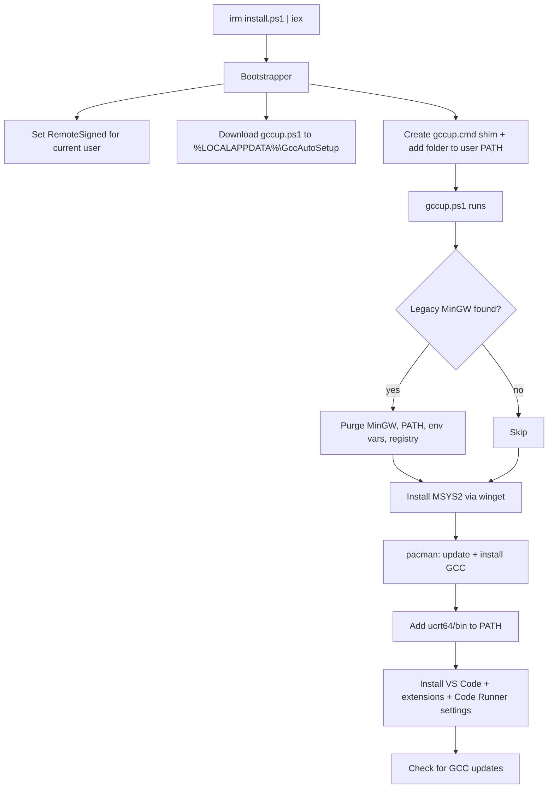

<div align="center">

#  GCC Auto Setup

### One command. A working C/C++ environment on Windows.

Installs **GCC & G++** (via MSYS2 UCRT64), fixes your **PATH**, cleans out old **MinGW**, and sets up **VS Code** for C/C++ — all automatically.


</div>

---

##  Why this exists

Setting up GCC on Windows is a rite of passage nobody enjoys: download MinGW, hunt for the right folder, edit PATH by hand, restart, realise it's the wrong version, repeat.

**GCC Auto Setup** replaces all of that with a single command. Run it on a brand-new PC and you get a modern compiler, a working PATH, and an editor ready to build and run C/C++ files.

---

##  Quick start

> **Run as Administrator.** Right-click PowerShell (or Command Prompt) and choose *Run as administrator*.

### PowerShell

```powershell
irm https://raw.githubusercontent.com/iabhnv19/gcc-auto-setup/main/install.ps1 | iex
```

### Command Prompt (cmd)

```bat
powershell -NoProfile -ExecutionPolicy Bypass -Command "irm 'https://raw.githubusercontent.com/iabhnv19/gcc-auto-setup/main/install.ps1' | iex"
```

That's it. The installer sets everything up and starts the setup immediately.

>  If you get stale results right after an update to this repo, add a cache-buster to the URL: `...install.ps1?v=2`

---

##  What it does

| # | Step | Details |
|:-:|------|---------|
| 1 |  **Legacy MinGW purge** | Detects old MinGW / TDM-GCC installs (e.g. GCC 6), removes them, and cleans related PATH entries, environment variables and uninstall registry entries |
| 2 |  **MSYS2** | Installs MSYS2 through `winget` if it's missing |
| 3 |  **GCC & G++** | Updates MSYS2 and installs `mingw-w64-ucrt-x86_64-gcc` (UCRT64) |
| 4 |  **PATH** | Adds `C:\msys64\ucrt64\bin` to your user PATH so `gcc` and `g++` work in any terminal |
| 5 |  **VS Code & extensions** | Installs VS Code if needed, plus C/C++, C/C++ DevTools, C/C++ Extension Pack and Code Runner |
| 6 |  **Code Runner settings** | Turns on *Run In Terminal* and *Save File Before Run* so Code Runner works properly with console programs |
| 7 |  **Update check** | Checks for a newer GCC at the end and offers to update |

Everything is **idempotent**: already-installed pieces are detected and skipped, so you can safely run it again any time.

### Highlights

-  Custom golden ASCII banner with live system info (OS, MSYS2, GCC and VS Code status)
-  Shows a plan of what it will do and waits for your **Y** before changing anything
-  Won't touch MSYS2 or Git's bundled tools while hunting for legacy MinGW
-  The `gccup` command works from **cmd, PowerShell 5, PowerShell 7 and the VS Code terminal**
-  No PowerShell profile editing, so no profile or execution-policy errors on new machines

---

##  Usage

After installing, open a **new Administrator terminal** and run:

```text
gccup
```

You'll see the banner and the plan:

```text
  1. Legacy MinGW  Detect & remove old MinGW (v6 etc.) and clean PATH
  2. MSYS2         package manager + shell
  3. GCC & G++     C/C++ compiler (UCRT64)
  4. PATH          so modern 'gcc' and 'g++' work in any terminal
  5. VS Code       editor + C/C++ & Code Runner extensions
  6. Update check at the end, with an option to update GCC

  Press Y to start (anything else cancels)
```

Press **Y** to begin. Run `gccup` again whenever you want to check for compiler updates.

> After the first setup finishes, **open a new terminal** so the updated PATH applies everywhere.

---

##  Test your setup

Check the compilers:

```powershell
gcc --version
g++ --version
```

Then build a real program. Save this as `hello.cpp`:

```cpp
#include <iostream>

int main() {
    std::cout << "GCC is working!" << std::endl;
    return 0;
}
```

Compile and run it:

```powershell
g++ hello.cpp -o hello
.\hello
```

Or open the file in VS Code and click the **Run Code ▶** button from Code Runner.

---

##  What gets installed where

| Component | Location |
|-----------|----------|
| `gccup` command | `%LOCALAPPDATA%\GccAutoSetup` |
| MSYS2 | `C:\msys64` |
| Compiler binaries (`gcc`, `g++`) | `C:\msys64\ucrt64\bin` |
| GCC package | `mingw-w64-ucrt-x86_64-gcc` |
| VS Code settings (Code Runner) | `%APPDATA%\Code\User\settings.json` |

---

##  How it works



The bootstrapper installs a tiny `gccup.cmd` file that launches `gccup.ps1` with `-ExecutionPolicy Bypass`. Because it's a normal file on your PATH (not a PowerShell function in a profile), it works in every shell and never depends on execution-policy settings.

---

##  Troubleshooting

<details>
<summary><b>"Please run PowerShell as Administrator."</b></summary>

`gccup` needs admin rights to change system-level settings. Close the terminal, then right-click it and choose **Run as administrator**.
</details>

<details>
<summary><b><code>gccup</code> is not recognized</b></summary>

- Open a **new** terminal. Terminals opened before the install don't see the updated PATH.
- Check that `%LOCALAPPDATA%\GccAutoSetup` exists and contains `gccup.cmd`.
- If it's missing, run the install command again.
</details>

<details>
<summary><b><code>gcc</code> is not recognized after setup</b></summary>

- Open a **new** terminal.
- Check that `C:\msys64\ucrt64\bin\gcc.exe` exists.
- If it does, make sure `C:\msys64\ucrt64\bin` is in your user PATH (`Win + R` → `sysdm.cpl` → *Advanced* → *Environment Variables*).
- If it doesn't, run `gccup` again.
</details>

<details>
<summary><b>"running scripts is disabled on this system"</b></summary>

The installer sets the execution policy to `RemoteSigned` for your user automatically. If your PC is managed (work or college), Group Policy may block that change. The `gccup` command still works, because it launches with `-ExecutionPolicy Bypass`.

If you still need to fix it manually:

```powershell
Set-ExecutionPolicy RemoteSigned -Scope CurrentUser
```
</details>

<details>
<summary><b>Old PowerShell profile errors (<code>Microsoft.PowerShell_profile.ps1</code>)</b></summary>

Early versions of this tool added a function to your PowerShell profile. The current installer removes that block automatically. Just run the install command once more.
</details>

<details>
<summary><b><code>winget</code> is not found</b></summary>

Install or update **App Installer** from the Microsoft Store, then run `gccup` again.
</details>

<details>
<summary><b>MSYS2 or GCC install fails</b></summary>

- Check your internet connection.
- Run `gccup` again. Package downloads can fail on a bad connection, and a second run picks up where the first stopped.
- If MSYS2 lives somewhere other than `C:\msys64`, update the `$root` path in `gccup.ps1`.
</details>

<details>
<summary><b>Download fails with a TLS / SSL error</b></summary>

The bootstrapper enables TLS 1.2 automatically. If it still fails, update Windows or run the cmd one-liner from [Quick start](#-quick-start).
</details>

---

##  FAQ

**Is this safe to run?**
It's open source, so you can read every line. See [Security](#-security).

**Does it work offline?**
No. It downloads MSYS2, GCC packages and VS Code.

**Why UCRT64 and not MinGW-w64 or MSVC?**
UCRT64 is the modern MSYS2 environment. It uses Windows' Universal C Runtime and gives you a current GCC with up-to-date libraries.

**Will it break my existing setup?**
It only removes *legacy* MinGW / TDM-GCC installs, and only after showing you the plan and getting a **Y**. MSYS2 and Git are explicitly left alone.

**Can I run it more than once?**
Yes. Installed components are detected and skipped, and the update check at the end keeps GCC current.

**Does it work on Windows 7 / 8?**
No. It targets Windows 10 and 11 and relies on `winget`.

---

##  Uninstall

Remove the `gccup` command:

```powershell
Remove-Item "$env:LOCALAPPDATA\GccAutoSetup" -Recurse -Force
```

Then remove `%LOCALAPPDATA%\GccAutoSetup` from your user PATH (*Environment Variables* dialog).

Optionally remove the toolchain too:

```powershell
winget uninstall MSYS2.MSYS2
```

and delete `C:\msys64\ucrt64\bin` from your user PATH.

---

##  Security

This project downloads and runs PowerShell code from GitHub, so **read the scripts before you run them**, especially `install.ps1` and `gccup.ps1`.

It makes these system changes:

- Installs MSYS2 and VS Code through `winget`
- Adds folders to your **user PATH**
- Sets the PowerShell execution policy to `RemoteSigned` for the **current user** (if it was more restrictive)
- Edits your VS Code `settings.json` (adds two Code Runner options)
- May delete legacy MinGW / TDM-GCC folders, related environment variables and their uninstall registry entries, after you confirm

Administrator rights are required.

---

##  Repository structure

```text
gcc-auto-setup/
├── install.ps1    # Bootstrapper: installs the gccup command
├── gccup.ps1      # Main setup script
├── README.md      # You are here
├── LICENSE        # MIT License
└── .gitignore
```

---

##  License & author

Released under the [MIT License](LICENSE).

<div align="center">

**Made with ❤️ and PowerShell by [Abhinav](https://github.com/iabhnv19)**

 If this saved you time, consider starring the repo!

*C/C++ on Windows, one command at a time.*

</div>
